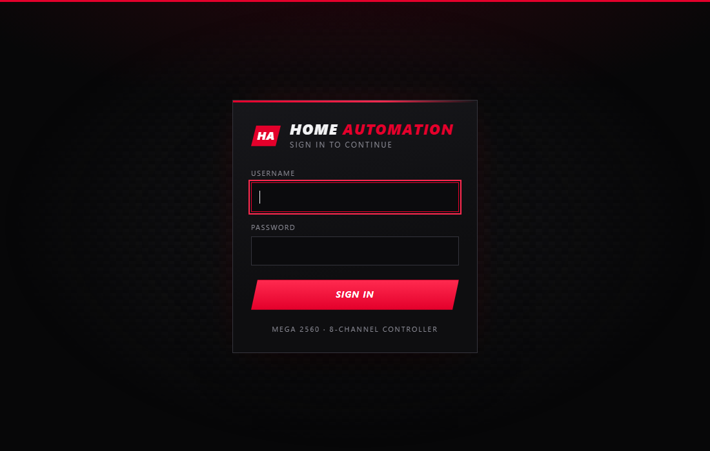
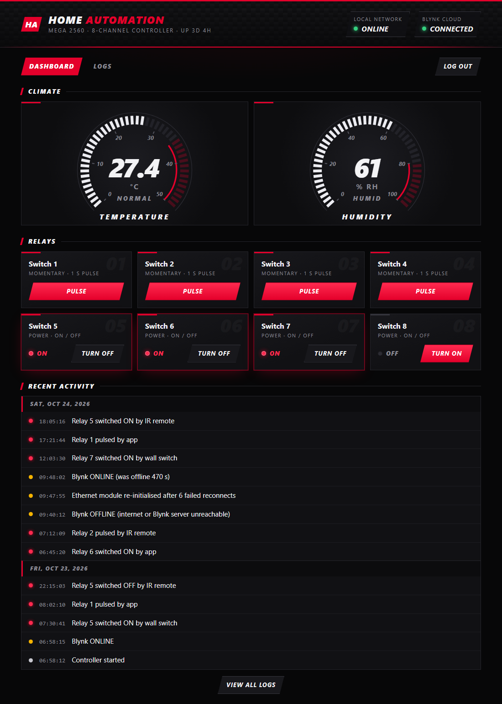

# Arduino Home Automation

An Arduino Mega controller for 8 relays. You can switch them from wall switches, an IR remote, the Blynk app, or a web page on your NAS. Local control keeps working when the internet or the network is down. Events are logged to a NAS as one text file per day.

## Features

- **8 relays (active LOW)**
  - Relays 1–4 are *momentary*. They pulse for 1 s, for things like gate or garage openers.
  - Relays 5–8 are *power* relays that toggle on and off.
- **Four ways to control them:** wall push buttons, an NEC IR remote, the Blynk app, and a web app on the NAS. The web app talks to the controller over the LAN, so it keeps working when the internet or Blynk is down.
- **Offline-first.** Switches and IR never wait on the network.
  - Blynk reconnects in the background, retrying less often the longer it's offline.
  - The ENC28J60 is re-initialised only after repeated failures.
- **State sync.** A relay toggled locally while offline is pushed to the app when Blynk reconnects, instead of the app switching it back.
- **DHT11 temperature and humidity** go to Blynk and to a 128×64 SSD1306 OLED. The OLED also shows Blynk status, the IP address and the DNS server.
- **Event log on a NAS** (optional). Events are sent over UDP to a small Python service that writes `YYYY-MM-DD.txt` files. Events that happen while the LAN is down are queued and delivered later with their original time.

## Hardware

| Part | Pin(s) |
|---|---|
| Arduino Mega 2560 | — |
| ENC28J60 Ethernet module | SPI (50–53) |
| Relays 1–8 | 45, 43, 41, 39, 37, 35, 33, 31 |
| Wall push buttons 1–8 (to GND, internal pull-up) | 44, 42, 40, 38, 36, 34, 32, 30 |
| IR receiver | 2 |
| DHT11 | 6 |
| SSD1306 OLED (I²C, 0x3C) | SDA 20, SCL 21 |

> Power the ENC28J60 from its own 3.3 V regulator, or use the 5 V version of the module. It draws around 150–180 mA. Running it from the Mega's 3.3 V pin can cause lockups that no code can recover from.

## Firmware setup

1. Install these libraries in the Arduino IDE:
   - EthernetENC (the ENC28J60 stack Blynk uses; UIPEthernet is not needed)
   - Blynk
   - DHT sensor library (Adafruit), plus Adafruit Unified Sensor
   - Adafruit GFX and Adafruit SSD1306
   - Time
   - IRremote (4.x)
2. Copy `HomeAutomation/secrets.example.h` to `HomeAutomation/secrets.h` and fill in your Blynk template ID, template name and auth token. If you use the web app, also set `LOCAL_CONTROL_KEY` to a random string (no spaces, up to 32 characters). `secrets.h` is git-ignored.
3. Near the top of `HomeAutomation.ino`, choose the network mode:
   - `USE_STATIC_IP 1` (recommended): set `staticIP`, `dnsIP`, `gatewayIP` and `subnetMask`. Use an address outside your router's DHCP pool. Re-initialising Ethernet never blocks in this mode.
   - `USE_STATIC_IP 0`: use DHCP. Re-initialising Ethernet can block for up to 10 s (`dhcpTimeout`) while the router itself is down. If you use the web app, reserve the controller's address in your router so it doesn't change.
4. Set `nasIP` to your NAS's address if you use the logger.
5. If your remote is different, replace the codes in `irCodes[]`. Entries 0–7 map to relays 1–8.

### Blynk virtual pins

| Pin | Function |
|---|---|
| V0–V3 | Pulse relays 1–4 (push button) |
| V4–V7 | Relays 5–8 on/off (switch) |
| V15 | Temperature (°C) |
| V16 | Humidity (%) |

## NAS event logger

`nas-logger/nas_logger.py` uses only the Python 3 standard library.

- It listens on UDP port 5140 and acknowledges each event, so the Arduino can resend anything lost.
- It appends each event to a text file for that day.
- If the Arduino's 60-second heartbeat goes quiet for more than 3 minutes, it writes a line noting the gap.

Run it directly:

```sh
LOG_DIR=/volume1/homeauto-logs python3 nas_logger.py
```

Or run it with Docker Compose, from the `nas-logger` folder:

```sh
docker compose up -d
```

By default, log files go to `nas-logger/logs`. To store them somewhere else, create a `.env` file next to `docker-compose.yml` containing, for example, `LOG_PATH=/volume1/homeauto-logs`. View the live output with `docker compose logs -f`.

If the NAS has a firewall, allow UDP port 5140 from the controller.

Example log:

```
2026-10-22 22:10:56  Controller started
2026-10-22 22:11:40  Relay 5 switched ON by IR remote
2026-10-22 22:12:03  Relay 2 pulsed by app
2026-10-22 23:40:12  Blynk OFFLINE (internet or Blynk server unreachable)
2026-10-22 23:42:30  Ethernet module re-initialised after 6 failed reconnects
2026-10-22 23:55:01  Blynk ONLINE (was offline 889 s)
```

> The logger protocol has no authentication. Only expose it on a trusted LAN.

## Web app

| Login | Dashboard |
|---|---|
|  |  |

*Screenshots with sample data.*

`nas-logger/web_app.py` (Python 3 standard library only) serves a web page on port 8080. When `WEB_USER` and `WEB_PASSWORD` are set, it asks you to sign in first and keeps you signed in for 30 days (restarting the app signs everyone out). After signing in there are two tabs:

- **Dashboard.** Shows the controller's connection to the local network and to Blynk, its uptime, the temperature and humidity, and the 8 relays. You can pulse relays 1–4 and switch relays 5–8 on or off. It also shows the latest log entries.
- **Logs.** Browse every logged event, either all days or one day at a time. Filter by type (relay, network, system), search the text (e.g. `IR remote` or `Relay 5`), and download a single day as `.txt` or all logs as a `.zip`.

The web app talks straight to the controller over the LAN, never through the Blynk servers, so you can still control everything when the internet or Blynk is down. Commands go over UDP to the controller's `logPort` (5140), the same socket the event log uses. Each command carries `LOCAL_CONTROL_KEY`, and the controller ignores anything without it. A lost packet is resent with the same request id, so a pulse never runs twice. Changes made from the web page are logged as `by web app` and are pushed to the Blynk app when it's connected.

Connection status on the dashboard:

| Indicator | Meaning |
|---|---|
| Local network: Online | The controller answered the web app over the LAN. |
| Local network: Unreachable | No answer after 3 tries. The controller is off or disconnected, `DEVICE_IP` is wrong, or `DEVICE_KEY` doesn't match `LOCAL_CONTROL_KEY`. |
| Blynk cloud: Connected / Offline | The controller's own connection to the Blynk server, as reported by the controller. |

It starts together with the logger when you run `docker compose up -d`. To configure it, add these lines to the `.env` file next to `docker-compose.yml`:

```sh
DEVICE_IP=192.168.1.50                  # the controller's address
DEVICE_KEY=same-as-LOCAL_CONTROL_KEY    # from secrets.h
WEB_USER=admin
WEB_PASSWORD=choose-a-strong-password
# RELAY_NAMES=Gate,Garage           # optional; relays show as Switch 1-8 by default
WEB_PORT=8080                           # optional, host port
```

Then open `http://<nas-ip>:8080`. Without `DEVICE_IP` the page shows the logs only.

> The page can open the gate and the garage. Always set `WEB_USER` and `WEB_PASSWORD`. The login and the LAN commands are not encrypted, so this is only suitable on a trusted LAN. For access from outside, use a VPN (e.g. WireGuard or Tailscale) or a reverse proxy with HTTPS. Don't forward the port directly.

To run it without Docker:

```sh
LOG_DIR=/volume1/homeauto-logs DEVICE_IP=192.168.1.50 DEVICE_KEY=... WEB_USER=admin WEB_PASSWORD=... python3 web_app.py
```
